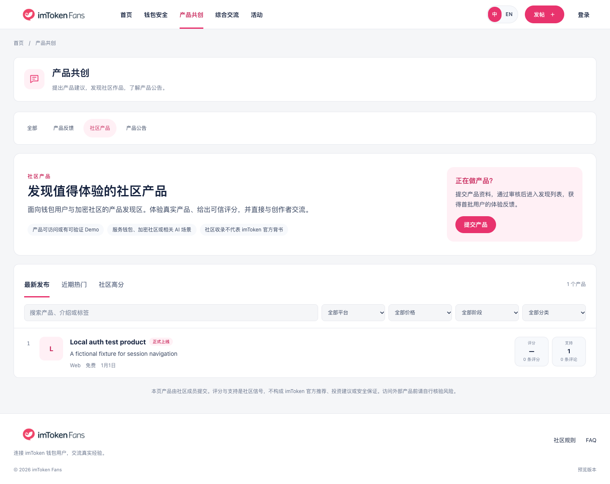
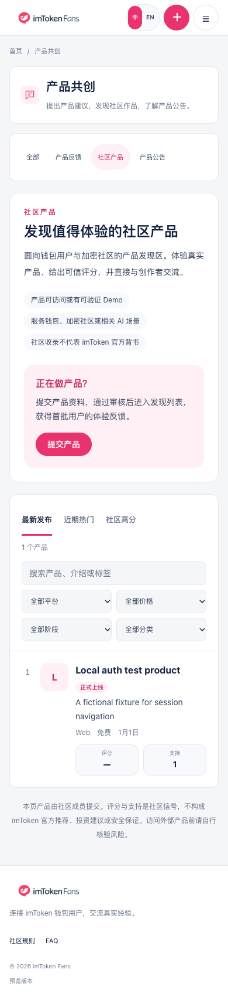

# 社区产品原位接入 review

日期：2026-10-16。分支：`codex/community-products-in-place`。状态：实现和本地验证完成，等待用户 review。

## 可查看结果

- 进入产品共创，点击原有「社区产品」分类，原位显示已实现的产品发现、搜索、平台/价格/阶段/类别筛选、排序和提交入口。
- 不再显示「进入产品猎手」引流块，也没有新增一级导航。社区产品使用原论坛外壳，其他分类保持原行为。
- 分类变化只替换当前区域并同步 query，不请求新页面、不打开新标签。刷新、语言切换、从详情/其他板块返回后均保留对应分类。
- `/zh/products`、`/en/products` 兼容到对应语言的 `/community/feedback?category=builds`；已有产品详情地址保留，详情内可以返回社区产品分类。
- 产品查询失败在区域内提示，不影响产品反馈/公告；现有公开列表失效 helper 已纳入社区页面。

## 验证

- i18n 1248 键、ESLint、生产构建 / TypeScript 通过。
- 10 项既有登录回归通过；新增 7 项入口和分类回归通过。覆盖原位切换不发生页面请求、筛选状态保留、旧地址兼容、详情返回、投稿登录回跳、语言切换、浏览器返回以及查询失败隔离。
- 中英桌面 1440×1080 与手机 390×844 检查。手机无横向溢出；筛选双列、产品计数指标移至下方，保留标题宽度。
- 独立 QA 确认原语言切换丢 query 问题，已修复并通过回归；修正复核无剩余确认问题。
- 测试只运行本地 `tests/helpers/auth-api.mjs` 和虚构账号/产品，不接真实数据库。截图中的英文产品名是测试数据，不是已发布的社区作品。

## 截图

中文桌面：

中文手机：

英文 [桌面](screenshots/community-products-in-place/en-desktop.png) / [手机](screenshots/community-products-in-place/en-mobile.png)。

## 范围与限制

- 分支包含现有登录修复 `164d0d9`（PR #7），本批未重写账号、权限、RLS、审核、数据库或 SQL。
- 本地普通预览仍没有真实 Supabase 配置，显示空产品列表；真实业务验收仍受既有 [M3-C QA](M3-C-product-hunter-security.md) 记录约束。
- 仅交付本批 UI/入口修正；尚未合入 main，也未声明线上更新完成。
