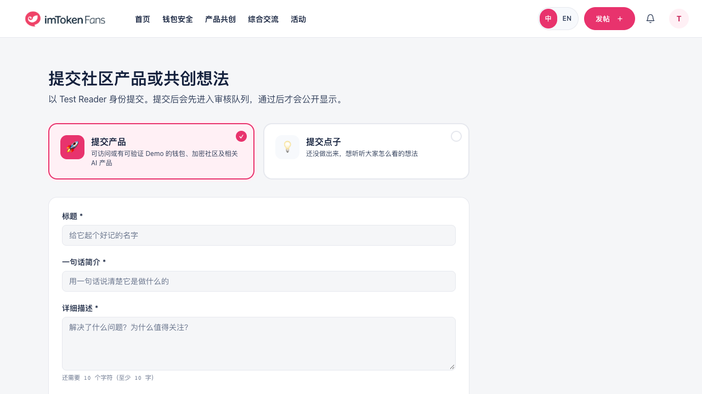
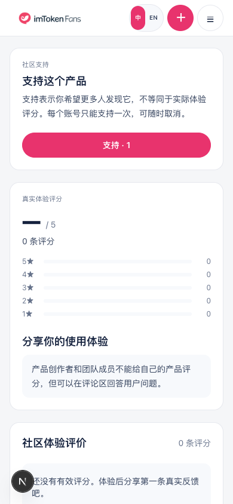

# Product Hunter 社区登录体验 review

2026-10-16。分支 `codex/product-hunter-auth-ux`，基于主线 `e1c40b1`。原目录未提交的 `feature/posting-ux-review` 工作未改动。

## 用户可见变化

- 投稿页、顶栏和互动区在会话检查结束前显示同一加载状态，不把加载中的用户误判为游客。
- 游客提交产品直接进入社区现有登录页，不再经过独立的“登录后才能提交”页面；登录后回到原产品/点子类型。
- 支持、评分、评论都使用统一社区登录地址，保留当前语言和详情操作锚点；Google/邮箱回调与首次引导使用同一回跳规则。
- 产品互动跟随全站用户；退出或切换账号时清除上一账号的本地互动状态，个人支持状态刷新完成前保持加载，避免误撤销已有支持。
- 旧账号慢请求不能覆盖退出/切换后的会话；业务资料查询缺失不再使产品互动永久加载。

## 验证

`check-i18n`（1249 键）、lint、build/TypeScript 均通过。10 条 Playwright 回归通过，覆盖中英文、390px 手机和桌面、加载延迟、密码登录后的返回导航、跨标签退出/账号切换、作者自评限制、错误回调语言、安全站内回跳、支持状态刷新与资料缺失。独立只读 QA 已对发现问题逐项复核，无本批阻塞。

测试使用本地虚构会话/API，不连接真实数据库，不验证真实密码、Google、邮箱发送或钱包签名。不包含之前已记录的审核/RLS及草稿生命周期问题的修复。

## 截图

下列截图均为自动化回归的虚构账号/产品，不是正式站数据。

本次没有新增数据库迁移或认证服务。回退本分支提交即可恢复原交互，不影响已有用户或投稿数据。
