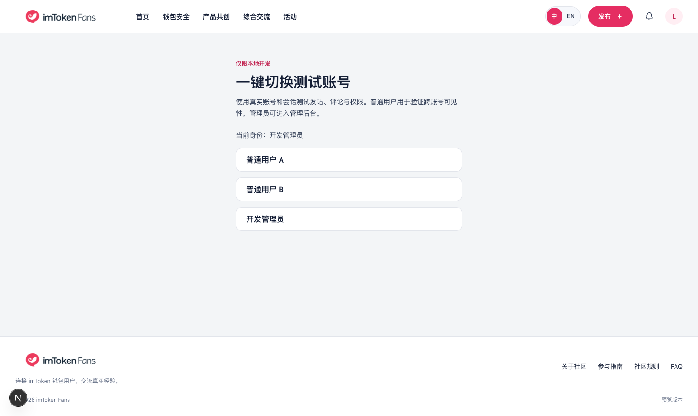

# 本地一键开发登录

日期：2026-10-16。分支：`codex/local-supabase`。用户希望在本地使用方便开发的认证机制。

## 交付

独立 `/zh/dev/login`、`/en/dev/login` 页面提供普通用户 A、普通用户 B、管理员三个按钮。使用真实 Supabase 密码登录和既有 SSR cookie；完整导航刷新客户端身份，不伪造认证状态，不跳过 RLS、审核或后台权限。已登录时也能切换账号。

账号准备与登录分离。`npm run setup:dev-auth` 在本地库创建固定 ID、邮箱和 `app_metadata.local_dev_auth=true` 的明确开发账号，设定 user/user/admin 角色；随机密码仅保存在 Git 忽略、权限 0600 的 `.env.local`，重复运行只操作该机制拥有的账号。运行时登录不调用 service-role API，不创建用户、不提升角色，只接受固定账号 key。

## 开关与边界

共享策略在 `src/lib/local-dev-auth.ts`。页面与 Server Action 分别校验：

- NODE_ENV 严格为 development。
- LOCAL_DEV_AUTH_ENABLED 严格为 true。
- Supabase URL 严格为 http://127.0.0.1:54321。
- 站点地址、原始 Host 必须为 localhost 或 127.0.0.1 的 HTTP 4000。
- POST Origin 必须存在且与原始 Host 完全匹配，不以转发头作为授权依据。

拒绝时在读取开发密码和创建认证客户端之前结束。密码、service-role key 不进入页面 props、客户端代码、action 返回值或日志。生产/未启用/远程数据库下页面不可用，action 也独立拒绝直接调用。

## 验证

- `npm run test:dev-auth`：23 个 action 案例加 GET 策略检查通过，覆盖生产/test 模式、开关关闭/缺失、远端/其他本地服务、异常站点/Host/Origin、跨回环来源、缺 Origin、未知身份、重复回跳参数和登录返回的身份被替换；拒绝输入时断言拒绝先于密码读取和客户端创建，后端身份不符则退出会话。
- 浏览器真实 A 登录、A→B 切换通过；服务器页面确认当前身份随 SSR 会话变化。
- A 通过真实 API 创建待审核帖子，浏览器 A 可读，切到 B 后不可读；B 访问 /admin 被正常权限重定向。
- 英文开发登录页点击管理员，进入原管理后台，显示 Local Dev Admin；临时待审核帖子和队列/账本精确清理，三个开发账号保留。
- lint、1588 键 i18n、生产构建通过；394 个客户端资源与页面 HTML 扫描未包含开发密码/service-role key。隔离的临时生产进程以允许的 Host 请求开发入口仍返回 HTTP 404，已关闭验证进程，4000 开发服务保持运行。
- 重复准备账号时捕获并修复已有会话失效：Supabase 重设相同密码也会撤销会话。脚本改为先用独立客户端验证旧凭证，只退出该临时会话（scope: local），仅凭证确实无效时更新密码；浏览器管理员登录→重复 setup→页面仍显示管理员的实测通过。
- 独立 Auth QA 初审 OK，确认服务端门禁、固定身份、所有权和幂等会话修复；指出重复 redirect 查询参数在页面上可能为数组，已改为只接收单一字符串，重复值安全回退。实际中英文异常查询 HTTP 200、23 项 action 回归、定向 lint 和重新构建通过；原审查者复核结论 **OK / No issues found**。独立审查为只读源码检查，实际 23 个案例、HTTP 回归、浏览器与构建由主调度验证。

## Draft PR 提交前同步与复验

2026-10-16：用户要求提交 Draft PR。任务改动定向暂存、保存后，将最新 `origin/main`（`9cd7be7`，包含 bman 首页入口）合入当前分支；恢复全部任务文件，翻译与路线图自动合并，无冲突。上游 bman 文案及记录完整保留，未改变本批认证实现。同步后 `npm run lint`、`npm run build`、`npm run check-i18n`（**1592 键**）、`npm run test:dev-auth`（23 个 action 案例加 GET 检查）、`npm run test:db:local`（11 项）全部通过。

开发登录页实际截图：

既有 31 个迁移和依赖锁文件未改；不提交 `.env.local`、真实凭证、数据库状态和私有运行日志。独立 Auth QA 结论仍适用于当前实现；本轮同步仅整合主线文案/首页，无认证行为改动。不在运行中的真实 4000 服务上启动 Playwright mock 配置；本批已用真实浏览器验证会话和权限。

## 使用

1. 启动本地 Supabase 和 4000 开发服务。
2. 首次或数据库重置后运行 `npm run setup:dev-auth`。
3. 打开 http://localhost:4000/zh/dev/login，点击身份。管理员进入 /admin；用户进入首页，支持安全站内 redirect 参数。
4. 要关闭入口，将 `.env.local` 的 LOCAL_DEV_AUTH_ENABLED 改为 false；生产模式无论开关如何均不可用。

没有新增表或迁移，没有配置第三方 OAuth。保留正常登录与退出流程；本地开发账号不代表真实用户，测试内容不作为社区运营内容。

| 风险 | 可能性 | 缓解 |
| --- | --- | --- |
| 开发管理员入口泄漏到远端 | 低 | 多条件服务端关闭、固定身份、POST Origin 检查、生产禁用与直接 action 测试 |
| 切换后保留上个账号的客户端状态 | 低 | SSR cookie + 完整导航，浏览器 A/B 切换及隔离实测 |
| 准备脚本误改真实账号 | 低 | 严格本机目标，固定 ID、邮箱及仅管理员可写 app_metadata 所有权检查 |

核心原则：让选择身份更方便，同时保留真实认证与权限语义。
